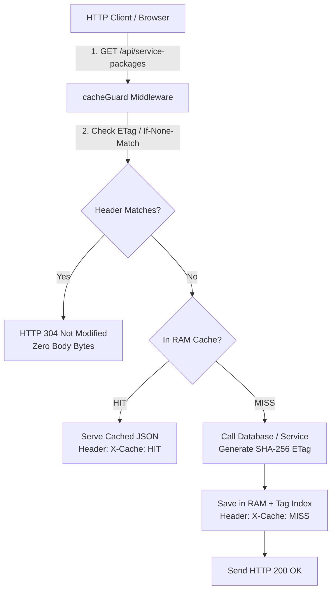

# ⚡ Adaptive Cache Engine Architecture & Workflow Guide

> **Feature Slice:** `server/features/aitag-cache/`  
> **Location:** `workflows/cache_and_performance_workflow.md`  
> **Mount Point:** `/api/cache`  
> **Performance Contract:** Sub-millisecond reads from RAM, HTTP 304 zero-body responses, and automated tag invalidation on DB writes.

---

## 1. Executive Summary

The `aitag-cache` slice provides a zero-dependency, in-RAM adaptive cache engine directly integrated into the AITAG Fractal Kernel. It solves database load bottlenecks on high-frequency read endpoints (`/api/service-packages`, `/api/tasks`, `/api/analytics/me`) while maintaining strict multi-tenant data isolation and instant invalidation.



---

## 2. Core Architectural Pillars

### 1. Cryptographic ETag & HTTP 304
Every cached response automatically generates a deterministic SHA-256 ETag:
```javascript
res.setHeader('ETag', entry.etag);
if (req.headers['if-none-match'] === entry.etag) {
  res.setHeader('X-Cache', 'HIT (304)');
  return res.status(304).end(); // 0 bytes transferred over the network
}
```

### 2. O(1) Reverse Tag Indexing
Entries can declare one or multiple tags (e.g., `'packages'`, `'tasks'`, `'orders'`, `user:client@aitag.com`).  
When a database mutation occurs, invalidation is instant and targeted:
```javascript
// Inside service.js or routes.js after DB write:
const cacheService = require('../aitag-cache/service');
cacheService.invalidateByTag('tasks');
cacheService.invalidateByTag(`user:${userEmail}`);
```

### 3. In-RAM LRU Capacity Eviction
To prevent memory exhaustion in high-throughput environments:
- Maximum default capacity: **5,000 entries**.
- Eviction strategy: Monotonic access order tracking (`accessCounter`).
- Guaranteed: Oldest, least-accessed items are cleanly evicted when capacity is reached.

### 4. Tenant Namespace Isolation (`scope: 'user'`)
For authenticated user endpoints (e.g. `/api/analytics/me` or `/api/tasks/my`):
- Setting `scope: 'user'` automatically prefixes cache keys with `user:<email>:`.
- Prevents data leakage between different logged-in users.

---

## 3. How to Apply Caching to a Feature Slice

To add caching to any endpoint in a Fractal Kernel slice:

```javascript
// 1. Import cacheGuard from aitag-cache
const { cacheGuard } = require('../aitag-cache/routes');

// 2. Attach middleware to GET route
router.get(
  '/my-data',
  auth,
  cacheGuard({
    ttlMs: 60000,                  // 60 seconds
    scope: 'user',                 // Isolate per authenticated user
    tags: (req) => ['my-data', `user:${req.user?.email}`] // Dynamic tag list
  }),
  async (req, res) => {
    const data = await service.getData(req.user.id);
    res.json(data);
  }
);
```

---

## 4. Observability & Telemetry Endpoints

### Live Metrics
`GET /api/cache/stats`
```json
{
  "success": true,
  "service": "aitag-cache",
  "status": "active",
  "keysCount": 18,
  "maxCapacity": 5000,
  "activeTagsCount": 4,
  "tags": ["packages", "tasks", "analytics", "user:client@aitag.com"],
  "metrics": {
    "hits": 1420,
    "misses": 88,
    "hitRatio": 0.9416,
    "sets": 88,
    "evictions": 0,
    "purges": 5
  }
}
```

### Manual or Webhook Purge
`POST /api/cache/purge`
```json
// Purge single tag:
{ "tag": "tasks" }

// Purge by key pattern:
{ "pattern": "analytics:*" }

// Purge entire cache:
{}
```
