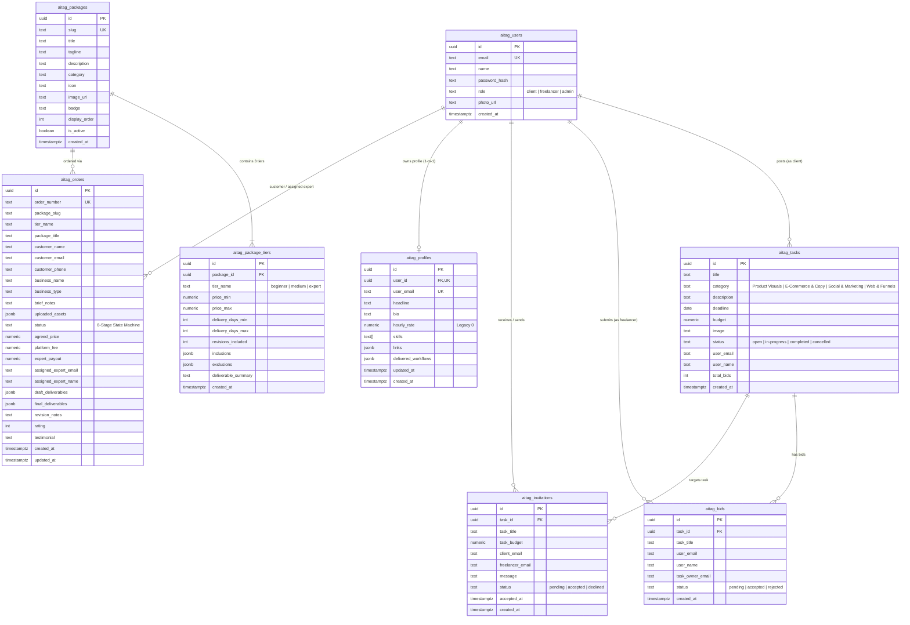

# 🗄️ AITAG Platform Database Architecture & Master Schema Reference

> **Target Platform:** AITAG SaaS AI Freelance Marketplace & Browser-Based AI Sandbox  
> **Location:** `workflows/database.md`  
> **Status:** Active Production & Staging Schema Reference  
> **Architecture:** Supabase (PostgreSQL 15+) with In-RAM Ephemeral Twin Fallbacks  
> **Last Verified:** October 2026 (Fractal Kernel 15 Slices)

---

## ⚡ The Database Synchronization Contract

> [!IMPORTANT]
> **MANDATORY LLM & DEVELOPER INVARIANT:**  
> Every time a database schema change, table addition, new column, check constraint, index, or migration is created (inside `supabase/migrations/` or `server/supabase-migration.sql`), **this file (`workflows/database.md`) MUST be updated in the exact same commit.**  
> If an LLM or developer modifies the database without updating this file, they have violated repository architectural integrity.

---

## 1. Environments & Connection Registry

The AITAG platform utilizes two segregated Supabase PostgreSQL cloud databases:

| Environment | Supabase Project Ref | Direct URL | Dashboard URL | Env File | Active Usage |
| :--- | :--- | :--- | :--- | :--- | :--- |
| **Production** | `byekbjxiowkrtwpsxevz` | `https://byekbjxiowkrtwpsxevz.supabase.co` | [Supabase Prod Console](https://supabase.com/dashboard/project/byekbjxiowkrtwpsxevz) | `.env` | Live production traffic, hosted on Render (`https://aitag-dev.onrender.com/` / custom domain) |
| **Development** | `trdwewugrqdpopzqhkuk` | `https://trdwewugrqdpopzqhkuk.supabase.co` | [Supabase Dev Console](https://supabase.com/dashboard/project/trdwewugrqdpopzqhkuk) | `.env.development` | Zero-Mock PIET test harness, local staging server, ephemeral integration testing |

### IPv4 vs. IPv6 & Supabase Pooler Architecture
Direct PostgreSQL connections (`db.<ref>.supabase.co:5432`) enforce IPv6. Many local ISP networks, Docker containers, and CI runners operate on IPv4.
- **Node.js Application Layer:** Connects through `@supabase/supabase-js` using standard HTTPS REST endpoints (PostgREST), completely bypassing raw TCP IPv6 connection bottlenecks.
- **Raw SQL / Migration Tools:** When using raw PostgreSQL clients or the Supabase CLI, always connect via the **Supabase Transaction Pooler** (Supavisor):
  - **Host:** `aws-0-<region>.pooler.supabase.com`
  - **Port:** `6543` (Transaction mode) or `5432` (Session mode)
  - **User:** `postgres.<project-ref>`

---

## 2. Entity-Relationship Graph



---

## 3. Master Consolidated Schema (All 8 Tables)

### Table 1: `aitag_users`
- **Feature Slice:** `server/features/aitag-auth/`
- **Purpose:** Core user credentials, authentication identity, and RBAC roles.
```sql
CREATE TABLE IF NOT EXISTS aitag_users (
  id UUID PRIMARY KEY DEFAULT gen_random_uuid(),
  name TEXT NOT NULL,
  email TEXT UNIQUE NOT NULL,
  password_hash TEXT NOT NULL,
  photo_url TEXT DEFAULT '',
  role TEXT NOT NULL DEFAULT 'freelancer' CHECK (role IN ('client', 'freelancer', 'admin')),
  created_at TIMESTAMPTZ DEFAULT NOW()
);
CREATE INDEX IF NOT EXISTS idx_aitag_users_email ON aitag_users(email);
```

### Table 2: `aitag_tasks`
- **Feature Slice:** `server/features/aitag-tasks/`
- **Purpose:** Client-posted AI project briefs, budget allocations, and status tracking.
```sql
CREATE TABLE IF NOT EXISTS aitag_tasks (
  id UUID PRIMARY KEY DEFAULT gen_random_uuid(),
  title TEXT NOT NULL,
  category TEXT NOT NULL CHECK (category IN (
    'Product Visuals', 
    'E-Commerce & Copy', 
    'Social & Marketing', 
    'Web & Funnels'
  )),
  description TEXT NOT NULL,
  deadline DATE NOT NULL,
  budget NUMERIC NOT NULL CHECK (budget >= 499),
  image TEXT DEFAULT 'https://images.unsplash.com/photo-1677442135703-1787eea5ce01?w=800',
  status TEXT NOT NULL DEFAULT 'open' CHECK (status IN ('open', 'in-progress', 'completed', 'cancelled')),
  user_email TEXT NOT NULL,
  user_name TEXT NOT NULL,
  total_bids INT DEFAULT 0,
  created_at TIMESTAMPTZ DEFAULT NOW()
);
CREATE INDEX IF NOT EXISTS idx_aitag_tasks_user_email ON aitag_tasks(user_email);
CREATE INDEX IF NOT EXISTS idx_aitag_tasks_category ON aitag_tasks(category);
CREATE INDEX IF NOT EXISTS idx_aitag_tasks_status ON aitag_tasks(status);
```

### Table 3: `aitag_bids`
- **Feature Slice:** `server/features/aitag-bids/`
- **Purpose:** AI specialist proposal bids submitted against open tasks.
```sql
CREATE TABLE IF NOT EXISTS aitag_bids (
  id UUID PRIMARY KEY DEFAULT gen_random_uuid(),
  task_id UUID NOT NULL REFERENCES aitag_tasks(id) ON DELETE CASCADE,
  task_title TEXT NOT NULL,
  user_email TEXT NOT NULL,
  user_name TEXT NOT NULL,
  task_owner_email TEXT NOT NULL,
  status TEXT NOT NULL DEFAULT 'pending' CHECK (status IN ('pending', 'accepted', 'rejected')),
  created_at TIMESTAMPTZ DEFAULT NOW(),
  UNIQUE(task_id, user_email)
);
CREATE INDEX IF NOT EXISTS idx_aitag_bids_user_email ON aitag_bids(user_email);
CREATE INDEX IF NOT EXISTS idx_aitag_bids_task_id ON aitag_bids(task_id);
CREATE INDEX IF NOT EXISTS idx_aitag_bids_task_owner ON aitag_bids(task_owner_email);
```

### Table 4: `aitag_invitations`
- **Feature Slice:** `server/features/aitag-invitations/`
- **Purpose:** Direct client-to-freelancer invitations targeting specific tasks.
```sql
CREATE TABLE IF NOT EXISTS aitag_invitations (
  id UUID PRIMARY KEY DEFAULT gen_random_uuid(),
  task_id UUID NOT NULL REFERENCES aitag_tasks(id) ON DELETE CASCADE,
  task_title TEXT NOT NULL DEFAULT 'AI Task',
  task_budget NUMERIC DEFAULT 0,
  client_email TEXT NOT NULL,
  freelancer_email TEXT NOT NULL,
  message TEXT DEFAULT '',
  status TEXT NOT NULL DEFAULT 'pending' CHECK (status IN ('pending', 'accepted', 'declined')),
  accepted_at TIMESTAMPTZ,
  created_at TIMESTAMPTZ DEFAULT NOW(),
  UNIQUE(task_id, freelancer_email)
);
CREATE INDEX IF NOT EXISTS idx_aitag_invitations_freelancer ON aitag_invitations(freelancer_email);
CREATE INDEX IF NOT EXISTS idx_aitag_invitations_client ON aitag_invitations(client_email);
CREATE INDEX IF NOT EXISTS idx_aitag_invitations_task ON aitag_invitations(task_id);
```

### Table 5: `aitag_profiles`
- **Feature Slice:** `server/features/aitag-profile/`
- **Purpose:** AI specialist verified credentials, tooling stacks, and portfolio workflows.
```sql
CREATE TABLE IF NOT EXISTS aitag_profiles (
  id UUID PRIMARY KEY DEFAULT gen_random_uuid(),
  user_id UUID UNIQUE REFERENCES aitag_users(id) ON DELETE CASCADE,
  user_email TEXT NOT NULL UNIQUE,
  headline TEXT DEFAULT '',
  bio TEXT DEFAULT '',
  hourly_rate NUMERIC DEFAULT 0, -- Set to 0 in MVP (Service Package pricing model)
  skills TEXT[] DEFAULT '{}',
  links JSONB DEFAULT '{}',
  delivered_workflows JSONB DEFAULT '[]',
  updated_at TIMESTAMPTZ DEFAULT NOW(),
  created_at TIMESTAMPTZ DEFAULT NOW()
);
CREATE INDEX IF NOT EXISTS idx_aitag_profiles_email ON aitag_profiles(user_email);
```

### Table 6: `aitag_packages`
- **Feature Slice:** `server/features/aitag-service-packages/`
- **Purpose:** Curated fixed-price AI service packages (e.g., photo makeover, copy packs, landing pages).
```sql
CREATE TABLE IF NOT EXISTS aitag_packages (
  id UUID PRIMARY KEY DEFAULT gen_random_uuid(),
  slug TEXT UNIQUE NOT NULL,
  title TEXT NOT NULL,
  tagline TEXT NOT NULL,
  description TEXT NOT NULL,
  category TEXT NOT NULL CHECK (category IN (
    'Product Visuals', 
    'E-Commerce & Copy', 
    'Social & Marketing', 
    'Web & Funnels'
  )),
  icon TEXT NOT NULL,
  image_url TEXT,
  badge TEXT DEFAULT 'Popular',
  display_order INT DEFAULT 0,
  is_active BOOLEAN DEFAULT TRUE,
  created_at TIMESTAMPTZ DEFAULT NOW()
);
CREATE INDEX IF NOT EXISTS idx_aitag_packages_slug ON aitag_packages(slug);
CREATE INDEX IF NOT EXISTS idx_aitag_packages_category ON aitag_packages(category);
```

### Table 7: `aitag_package_tiers`
- **Feature Slice:** `server/features/aitag-service-packages/`
- **Purpose:** Three standardized pricing and scope tiers (`beginner`, `medium`, `expert`) per package.
```sql
CREATE TABLE IF NOT EXISTS aitag_package_tiers (
  id UUID PRIMARY KEY DEFAULT gen_random_uuid(),
  package_id UUID NOT NULL REFERENCES aitag_packages(id) ON DELETE CASCADE,
  tier_name TEXT NOT NULL CHECK (tier_name IN ('beginner', 'medium', 'expert')),
  price_min NUMERIC NOT NULL CHECK (price_min > 0),
  price_max NUMERIC NOT NULL CHECK (price_max >= price_min),
  delivery_days_min INT NOT NULL CHECK (delivery_days_min > 0),
  delivery_days_max INT NOT NULL CHECK (delivery_days_max >= delivery_days_min),
  revisions_included INT NOT NULL DEFAULT 1,
  inclusions JSONB NOT NULL DEFAULT '[]',
  exclusions JSONB NOT NULL DEFAULT '[]',
  deliverable_summary TEXT NOT NULL,
  created_at TIMESTAMPTZ DEFAULT NOW(),
  UNIQUE(package_id, tier_name)
);
CREATE INDEX IF NOT EXISTS idx_aitag_tiers_pkg_id ON aitag_package_tiers(package_id);
```

### Table 8: `aitag_orders`
- **Feature Slice:** `server/features/aitag-service-orders/`
- **Purpose:** 8-stage escrow lifecycle state machine for commissioned AI service packages.
```sql
CREATE TABLE IF NOT EXISTS aitag_orders (
  id UUID PRIMARY KEY DEFAULT gen_random_uuid(),
  order_number TEXT UNIQUE NOT NULL,
  package_slug TEXT NOT NULL,
  tier_name TEXT NOT NULL CHECK (tier_name IN ('beginner', 'medium', 'expert')),
  package_title TEXT NOT NULL,
  customer_name TEXT NOT NULL,
  customer_email TEXT NOT NULL,
  customer_phone TEXT DEFAULT '',
  business_name TEXT DEFAULT '',
  business_type TEXT DEFAULT '',
  brief_notes TEXT DEFAULT '',
  uploaded_assets JSONB NOT NULL DEFAULT '[]',
  status TEXT NOT NULL DEFAULT 'REQUESTED' CHECK (status IN (
    'REQUESTED',        -- 1. Customer submitted brief
    'QUALIFIED',        -- 2. Admin reviewed requirements
    'MATCHED',          -- 3. Expert assigned
    'SCOPE_CONFIRMED',  -- 4. Scope & timeline locked
    'PAID',             -- 5. Escrow deposit received
    'ACTIVE',           -- 6. Expert actively producing
    'DRAFT_SUBMITTED',   -- 7. First draft submitted
    'REVISION',         -- 8a. Customer requested revision
    'COMPLETED',        -- 8b. Approved with rating & payout
    'DISPUTED'          -- Escrow arbitration
  )),
  agreed_price NUMERIC NOT NULL CHECK (agreed_price >= 0),
  platform_fee NUMERIC DEFAULT 0,    -- 5% platform commission
  expert_payout NUMERIC DEFAULT 0,   -- 95% net expert payout
  assigned_expert_email TEXT DEFAULT '',
  assigned_expert_name TEXT DEFAULT '',
  draft_deliverables JSONB NOT NULL DEFAULT '[]',
  final_deliverables JSONB NOT NULL DEFAULT '[]',
  revision_notes TEXT DEFAULT '',
  rating INT DEFAULT 0 CHECK (rating >= 0 AND rating <= 5),
  testimonial TEXT DEFAULT '',
  created_at TIMESTAMPTZ DEFAULT NOW(),
  updated_at TIMESTAMPTZ DEFAULT NOW()
);
CREATE INDEX IF NOT EXISTS idx_aitag_orders_customer_email ON aitag_orders(customer_email);
CREATE INDEX IF NOT EXISTS idx_aitag_orders_expert_email ON aitag_orders(assigned_expert_email);
CREATE INDEX IF NOT EXISTS idx_aitag_orders_status ON aitag_orders(status);
CREATE INDEX IF NOT EXISTS idx_aitag_orders_order_number ON aitag_orders(order_number);
```

---

## 4. Triggers & Custom Functions

### Denormalized Bid Counter Trigger
Maintains an accurate `total_bids` count on `aitag_tasks` without expensive `COUNT(*)` table scans:
```sql
CREATE OR REPLACE FUNCTION increment_task_bid_count()
RETURNS TRIGGER AS $$
BEGIN
  UPDATE aitag_tasks SET total_bids = total_bids + 1 WHERE id = NEW.task_id;
  RETURN NEW;
END;
$$ LANGUAGE plpgsql;

DROP TRIGGER IF EXISTS on_bid_inserted ON aitag_bids;
CREATE TRIGGER on_bid_inserted
  AFTER INSERT ON aitag_bids
  FOR EACH ROW EXECUTE FUNCTION increment_task_bid_count();
```

---

## 5. Security & Row-Level Security (RLS) Policy Matrix

To guarantee immunity against autonomous AI scraping, PostgREST table dumping, and IDOR/BOLA attacks:

| Table | RLS Enabled | Anon Read | Anon Write | Authenticated Access | Service Role |
| :--- | :---: | :---: | :---: | :---: | :---: |
| `aitag_users` | **TRUE** | ❌ DENIED | ❌ DENIED | Self row only (`auth.uid() = id`) | Full Access |
| `aitag_tasks` | **TRUE** | ✅ Public open tasks | ❌ DENIED | Own tasks (`user_email = email`) | Full Access |
| `aitag_bids` | **TRUE** | ❌ DENIED | ❌ DENIED | Task owner or bidding freelancer | Full Access |
| `aitag_invitations` | **TRUE** | ❌ DENIED | ❌ DENIED | Client or invited freelancer | Full Access |
| `aitag_profiles` | **TRUE** | ✅ Public read | ❌ DENIED | Own profile only | Full Access |
| `aitag_packages` | **TRUE** | ✅ Public read | ❌ DENIED | Read-only; Admin mutates | Full Access |
| `aitag_package_tiers` | **TRUE** | ✅ Public read | ❌ DENIED | Read-only; Admin mutates | Full Access |
| `aitag_orders` | **TRUE** | ❌ DENIED | ❌ DENIED | Customer, Assigned Expert, or Admin | Full Access |

### Postgres Column-Level Security (Non-Negotiable)
Anonymous access to `password_hash` is explicitly revoked at the Postgres engine level:
```sql
REVOKE SELECT (password_hash) ON aitag_users FROM anon, authenticated;
```

---

## 6. In-RAM Ephemeral Fallback Store Architecture

When running in local sandboxes without live cloud internet, during automated test runs, or if Supabase experiences a network timeout, AITAG services employ resilient in-RAM fallback maps:

- **Orders (`aitag-service-orders`):** `inMemoryOrders = new Map()` stores full 8-stage orders with instant atomic lookup.
- **Packages (`aitag-service-packages`):** Built-in hardcoded fallback catalog of the 3 pilot packages and 9 tiers ensures UI never renders empty.
- **Tasks (`aitag-tasks`):** 8 featured AI service tasks persist in memory if DB connection is unavailable.
- **Teardown Invariant:** The PIET test harness assigns unique run nonces (`piet-client-${RUN_ID}@aitag-test.local`) and explicitly executes:
  ```javascript
  await supabase.from('aitag_orders').delete().eq('id', ephemeralOrderId);
  ```
  guaranteeing **zero ghost test records** linger in the database.

---

## 7. Migration & Rollback Runbook

### How to Apply a New Migration

1. **Create the Migration File:**
   - Save SQL in `supabase/migrations/<YYYYMMDDHHMMSS>_<descriptive_name>.sql`.
   - Always write idempotent SQL (`IF NOT EXISTS`, `ON CONFLICT DO NOTHING`).
2. **Execute via Supabase CLI (Preferred for CI/CD):**
   ```powershell
   $env:SUPABASE_ACCESS_TOKEN="<pat_token>"
   npx supabase link --project-ref trdwewugrqdpopzqhkuk -p "<DB_PASSWORD>"
   npx supabase db push
   ```
3. **Execute via Supabase Web SQL Editor:**
   - Open [Supabase SQL Editor](https://supabase.com/dashboard/project/byekbjxiowkrtwpsxevz/sql).
   - Paste the migration script and click **Run**.
4. **Update `workflows/database.md`:**
   - Immediately document new columns, types, or constraints in this file.
5. **Run Zero-Mock Verification:**
   ```powershell
   npm test
   ```
   Confirm all 8 PIET gates pass before committing to Git.

### How to Roll Back a Failed Migration
If a column migration causes failures:
```sql
-- Safe Down Migration Example
ALTER TABLE <table_name> DROP COLUMN IF EXISTS <column_name>;
```
Never drop active tables directly in production without a verified backup export from the Supabase dashboard.
