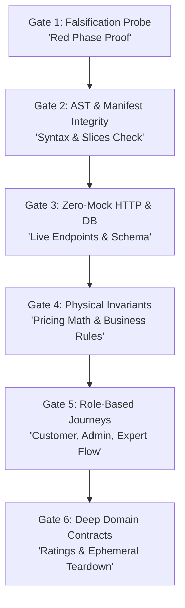

# PIET — Persistent In-RAM Ephemeral Twin Architecture & Workflow Guide

> **Target Platform:** AITAG Marketplace Platform  
> **Location:** `d:\Hayat\AITAG\workflows\piet_testing_workflow.md`  
> **Source Harness:** `tests/piet/piet.mjs` & `piet/piet.mjs`  
> **Execution Command:** `npm run test:piet` or `node tests/piet/piet.mjs`

---

## 1. Executive Summary & Philosophy

**PIET (Persistent In-RAM Ephemeral Twin)** is a **zero-mock, falsification-first integration testing architecture** designed for resilient AI coding agents and production reliability.

### The Problem With Traditional Mocks
Traditional unit tests rely heavily on mock libraries (Jest, Sinon). In complex micro-architectures, **mocks lie**:
- Mocks cannot catch broken SQL table constraints, missing columns, or database migration syntax errors.
- Mocks hide HTTP header parsing bugs, CORS misconfigurations, and authentication token issues.
- Browser E2E tests (Cypress, Playwright) take minutes to run and break on minor CSS tweaks.

### The PIET Solution
PIET tests the **complete, live production-ready system over the wire in RAM**:
1. **Live Network Layer:** Dispatches real HTTP requests over TCP (`http://localhost:5005`).
2. **Auto-Booting Twin:** If port 5005 is not already active, PIET boots an ephemeral In-RAM Express server twin, runs all assertions, and cleanly tears it down on completion.
3. **Real Database Layer:** Queries and writes directly to live Supabase PostgreSQL (Dev environment `trdwewugrqdpopzqhkuk`) with fallback in-memory verification.
4. **Mandatory Teardown Invariant:** Ephemeral unique run nonces (`piet-client-${RUN_ID}@aitag-test.local`) are wiped in `finally` blocks, guaranteeing **zero ghost records**.
5. **Blazing Speed:** Starts in ~0.05 seconds and executes all assertions in under 2 seconds.

---

## 2. The 6-Gate Falsification Architecture



### Gate 1: Falsification Probe (The "Red" Proof)
* **Objective:** Prove that the test harness itself is capable of catching genuine failures and is not a tautological "yes-man" suite.
* **Checks:**
  1. Closed port probe: Hits an unreachable port (`:59999`) and asserts network connection failure is caught.
  2. Negative input defense: Submits empty JSON payload to `/api/service-orders` and verifies HTTP 400 Bad Request.

### Gate 2: AST & Manifest Integrity
* **Objective:** Enforces Fractal Kernel slice rules.
* **Checks:**
  1. Validates that `feature.manifest.json`, `routes.js`, and `service.js` exist for every slice.
  2. Verifies manifest schema (`id`, `enabled: true`, `basePath`).

### Gate 3: Zero-Mock HTTP & DB Layer
* **Objective:** Verifies live data retrieval from Supabase.
* **Checks:**
  1. Hits `GET /api/service-packages` over TCP and asserts HTTP 200.
  2. Asserts the 3 launch packages exist (`ai-product-photo-makeover`, `ai-social-media-content-pack`, `ai-website-landing-page`).
  3. Asserts each package contains all 3 tiers (`beginner`, `medium`, `expert`).

### Gate 4: Physical Invariants & Business Safeguards
* **Objective:** Validates mathematical and operational boundaries.
* **Checks:**
  1. Invariant: `price_min <= price_max` across all tiers.
  2. Invariant: `delivery_days_min <= delivery_days_max`.
  3. Invariant: `revisions_included >= 1`.
  4. Commission Invariant: Platform fee must equal 5% of agreed price; expert payout must equal 95%.

### Gate 5: Role-Based Journeys
* **Objective:** Simulates the complete 8-stage operational flow across roles.
* **Checks:**
  1. **Customer Journey:** Submits brief (`REQUESTED`).
  2. **Admin Journey:** Assigns vetted expert (`MATCHED`).
  3. **Admin Activation:** Confirms payment receipt (`ACTIVE`).
  4. **Expert Delivery:** Submits draft files (`DRAFT_SUBMITTED`).
  5. **Revision Loop:** Customer requests included revision (`REVISION`).

### Gate 6: Deep Domain Contracts & Teardown
* **Objective:** Verifies acceptance, ratings, and cleanup.
* **Checks:**
  1. Customer approves final output with 5-star rating (`COMPLETED`).
  2. **Teardown Block:** Executes `DELETE` query on Supabase for the ephemeral test order ID, ensuring no residual test data in production/dev tables.

---

## 3. How to Run & Maintain PIET

```bash
# Run against local In-RAM twin (default: port 5005)
npm run test:piet

# Or directly via Node.js
node tests/piet/piet.mjs

# Run against custom host/port or remote preview
$env:TEST_BASE_URL="http://localhost:5005"
node tests/piet/piet.mjs
```

### Adding New Assertions to PIET
1. Open `tests/piet/piet.mjs`.
2. Locate the appropriate Gate function (`gate('Gate X: ...')`).
3. Add a new test using `await t('Descriptive name', async () => { ... })`.
4. Always use `assert(condition, 'Error message')` or `eq(actual, expected, 'Error message')`.
5. Ensure any database record created includes `RUN_ID` in its email/title, and add its cleanup to the `finally` block.
