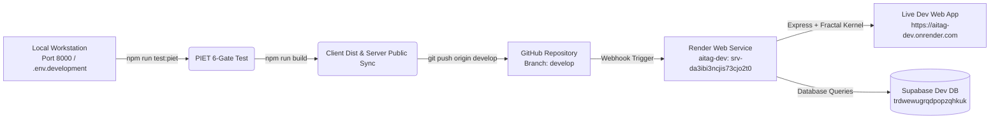

# Render Development Deployment Workflow (`aitag-dev`)

> **Environment:** Development / Staging  
> **Service Name:** `aitag-dev`  
> **Render Service ID:** `srv-da3ibi3ncjis73cjo2t0`  
> **Dashboard URL:** [Render Dashboard — aitag-dev](https://dashboard.render.com/web/srv-da3ibi3ncjis73cjo2t0)  
> **Live Web App:** [https://aitag-dev.onrender.com](https://aitag-dev.onrender.com)  
> **Git Branch:** `develop` (`Maqsood32595/AITAG`)  
> **Supabase Project:** `trdwewugrqdpopzqhkuk` (`AITAG_DEV`)  

---

## 1. Overview & Architecture

The `aitag-dev` service on Render serves as our live staging/development environment. It mirrors production infrastructure while isolating active development changes and testing new Fractal Kernel features against the dedicated Development Supabase database (`trdwewugrqdpopzqhkuk`).



---

## 2. Environment Variables Configuration (Render)

Configure these variables in the Render Dashboard under **aitag-dev** > **Settings** > **Environment**:

| Variable | Recommended Value | Purpose |
| :--- | :--- | :--- |
| `NODE_ENV` | `production` | Express production mode (or `development`) |
| `PORT` | `10000` | Port assigned by Render router |
| `SUPABASE_URL` | `https://trdwewugrqdpopzqhkuk.supabase.co` | Development Supabase endpoint |
| `SUPABASE_ANON_KEY` | *(Dev Anon Public Key)* | Supabase Client-side SDK queries |
| `SUPABASE_SERVICE_ROLE_KEY` | *(Dev Service Role Key)* | Server-side elevated DB operations |
| `GCS_CREDENTIALS` | *(Base64 JSON)* | Google Cloud Storage for direct-to-bucket video uploads |

> [!IMPORTANT]
> Never mix Production Supabase keys (`byekbjxiowkrtwpsxevz`) into the `aitag-dev` Render environment. The Dev environment must strictly point to `trdwewugrqdpopzqhkuk`.

---

## 3. Frontend Build & Static Asset Synchronization Pipeline

### The Render Static Assets Challenge
By default:
1. Vite outputs compiled frontend assets to `client/dist`.
2. `dist/` is listed in `.gitignore` to prevent repository bloat.
3. Render's Express server (`server/index.js`) checks for static assets in this priority:
   - Primary: `../client/dist` (if `index.html` exists)
   - Fallback: `../server/public` (used when `client/dist` is missing or unbuilt)

### The Solution: Root Build Script Sync
To guarantee that Render always serves the latest React frontend without stale caching or blank pages, the root `package.json` build command is configured as:

```json
"scripts": {
  "build": "cd client && npm run build && node -e \"const fs=require('fs'); fs.cpSync('client/dist', 'server/public', {recursive: true});\""
}
```

Whenever building or preparing for deployment:
1. Run `npm run build` from the workspace root.
2. Vite builds into `client/dist`.
3. Node copies the fresh bundles into `server/public`.
4. Commit `server/public` changes to `develop` before pushing.

---

## 4. Development & Deployment Workflow

### Step 1: Local Development on Port 8000
Run the local dev server using:
```powershell
node server/index.js
```
The server automatically detects `.env.development` and binds to **port 8000**:
- Web UI: `http://localhost:8000`
- API Base: `http://localhost:8000/api`

### Step 2: Database Schema Changes (Supabase Dev)
If schema migrations are needed:
1. Add migration SQL to `supabase/migrations/` (e.g. `20261011010000_pilot_packages.sql`).
2. Push to Dev Supabase using the CLI:
   ```powershell
   $env:SUPABASE_ACCESS_TOKEN="$env:SUPABASE_ACCESS_TOKEN" # or pass your Personal Access Token
   npx supabase link --project-ref trdwewugrqdpopzqhkuk -p "$env:DEV_DB_PASSWORD"
   npx supabase db push
   ```

### Step 3: Run PIET Test Suite (Zero-Mock In-RAM Twin)
Before pushing to `develop`, verify that all 6 gates pass:
```powershell
npm run test:piet
```
Ensure all 13 assertions succeed (Gate 1 Red Probe through Gate 6 Teardown).

### Step 4: Build Client Assets
Compile the React frontend and copy the bundles to `server/public`:
```powershell
npm run build
```

### Step 5: Commit and Push to `develop`
```powershell
git checkout develop
git add .
git commit -m "feat(packages): update pilot packages and copy"
git push origin develop
```

---

## 5. Render Deploy Management & Troubleshooting

### Triggering a Deploy
* **Auto-Deploy:** Pushing to `origin/develop` triggers a deploy automatically.
* **Manual Deploy:**
  1. Open [aitag-dev Deploys](https://dashboard.render.com/web/srv-da3ibi3ncjis73cjo2t0/deploys).
  2. Click **Manual Deploy**.
  3. Select **"Clear build cache & deploy"** if you need a clean build or updated package dependencies.

### Inspecting Server Logs
Navigate to the **Logs** tab in Render:
- Confirm kernel initialization:
  ```text
  [AITAG Kernel] Initializing Fractal Micro-Architecture...
  [AITAG Kernel] Loaded feature slice: aitag-service-packages
  [AITAG Kernel] Loaded feature slice: aitag-service-orders
  [AITAG Kernel] Registration complete. Active slices: 2
  Server running on port 10000
  ```

---

## 6. Post-Deploy Verification Checklist

Once Render marks the deploy as **Live**:

1. **API Health Check:**
   ```powershell
   curl -I https://aitag-dev.onrender.com/api/health
   # Expected: HTTP/1.1 200 OK
   ```

2. **Pilot Packages API Check:**
   ```powershell
   curl https://aitag-dev.onrender.com/api/service-packages
   # Expected: JSON array containing 3 pilot packages with 9 pricing tiers in INR
   ```

3. **Frontend UI Smoke Test (`https://aitag-dev.onrender.com`):**
   - [ ] Hero Headline displays: *"You Don't Need to Learn AI. We Deliver the Outcomes."*
   - [ ] 4 Audience Chips are visible: *D2C & E-Commerce*, *Creators & Influencers*, *Local Businesses & SMBs*, *Founders & Startups*.
   - [ ] 3 Core Pillars are rendered: *SIMPLE*, *TRUSTED*, *PRACTICAL*.
   - [ ] 3 Pilot Package Cards are interactive:
     - AI Product Photo Makeover (₹1,999 - ₹7,999)
     - AI Social Media Content Pack (₹2,999 - ₹9,999)
     - AI Website Landing Page (₹4,999 - ₹19,999)
   - [ ] Clicking **"Order Package"** opens the `OrderBriefModal` with all 3 tiers selectable.
   - [ ] Submitting brief creates an active order and shows confirmation.
